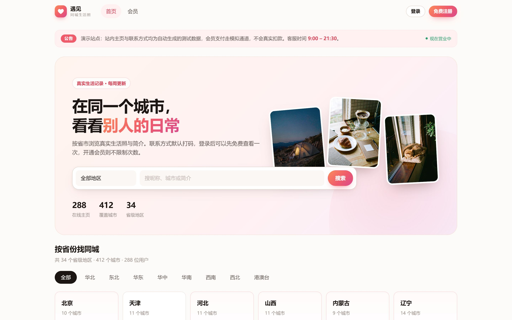
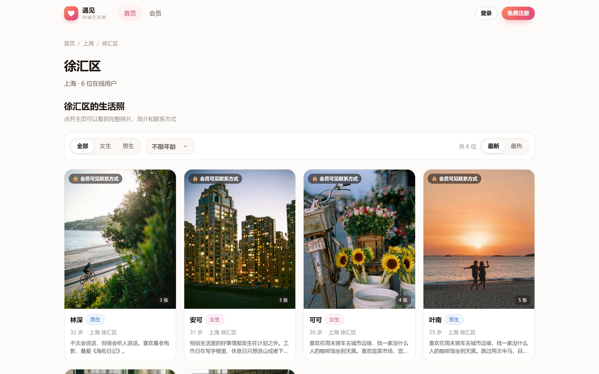
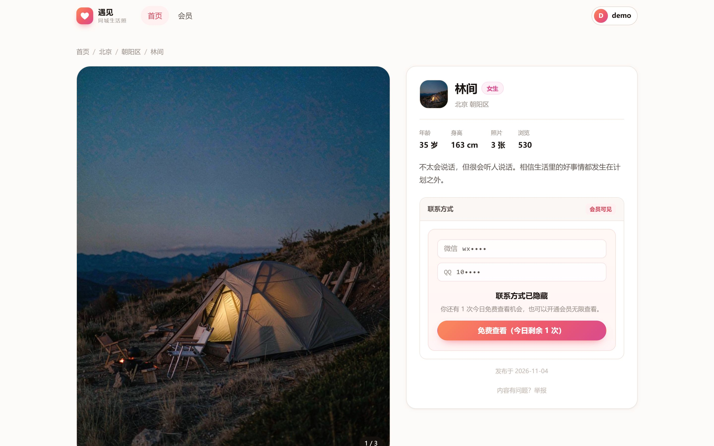

# 遇见 · 同城生活照平台

按「省份 → 城市」浏览生活照的同城社区。浏览免费，联系方式默认在服务端打码，登录后可以先免费看一次，会员不限次数。前后端都是我写的，没有用框架，也没有第三方依赖。

**在线演示**：<!--DEMO-->

| 账号 | 密码 | 说明 |
|---|---|---|
| `demo` | `Demo@123456` | 普通免费用户，用来走一遍付费墙 |
| `admin` | `Admin@123456` | 管理员，可以进 `/admin` 和 `/publish` |

> 演示环境的支付是模拟的：点「立即开通」会直接成功，不产生真实扣款。数据全部是脚本生成的测试内容。



## 为什么没用框架

写过 Express 那一套之后，这个站我故意选了最土的做法：

- Node 22 自带的 `http` 和 `node:sqlite` 已经够用，一个进程、一个 db 文件就是全部后端；
- 前端是原生 ES Module，浏览器直接跑，不需要 webpack/vite，改完刷新就行；
- 结果是 `npm install` 都不用执行，`node server/index.js` 就能起，扔到 1 核 1G 的小机器上也跑得动。

代价是所有东西都得自己写：路由、静态文件、会话、CSRF、限流、图片上传校验。写完对 HTTP 的理解确实比用框架时清楚很多。

## 功能

**浏览**
- 首页：8 大区 + 34 个省级地区入口，热门城市、最新加入
- 省份页 / 城市页：卡片列表，按性别、年龄筛选，按最新或最热排序，滚动加载更多
- 详情页：多图切换、简介、标签、浏览量和解锁数

**付费墙**
- 未解锁时接口只返回 `wx••••` 这种打码值，明文永远不会下发到前端
- 免费用户每天 1 次查看额度，会员无限
- 三档套餐（月/季/年），会员时长可以叠加；演示环境走模拟支付，也支持兑换码

**发布与审核**
- 默认只有管理员能发布，发完直接上线；`PUBLISH_MODE=user` 时开放用户投稿，进 pending 等审核
- 照片在前端 canvas 压到 1600px 再上传，后端校验 MIME、文件魔数和大小

**后台**
- 概览：用户、有效会员、在线主页、待审核、举报、累计收入
- 内容审核、举报处理、用户封禁（会同时下架其主页）、兑换码批量生成




## 几个实现上的细节

- **打码在服务端做**。`GET /api/profiles/:id` 会先判断当前用户有没有权限，没权限就拼一个打码字符串返回，抓包也拿不到原文。解锁是单独的 `POST /api/profiles/:id/unlock`，成功才返回明文。
- **密码用 scrypt**（N=16384）加随机盐，比较时 `timingSafeEqual`。登录失败时对不存在的账号也跑一次哈希，避免用响应时间枚举用户名。
- **会话是自签的 HS256 令牌**，放在 `HttpOnly` Cookie 里，密钥存在 `data/.secret`（下次启动复用，否则重启就掉登录）。
- **写请求校验来源**：优先看 `Sec-Fetch-Site`，同时比对 `Origin` 和本次请求的 Host，再要求带 `X-Requested-With` 头，三道都过才放行。反代场景下靠 `X-Forwarded-Host` 和 `ALLOWED_ORIGINS` 兜底。
- **前端不用 innerHTML 拼用户内容**，全部 `createElement`；页面外壳有 CSP，没有内联脚本。
- 所有 SQL 都是参数化的，没有字符串拼接。

## 本地运行

```bash
# 需要 Node >= 22.5（内置 node:sqlite）
node server/index.js
# 打开 http://localhost:5173
```

第一次启动会自动建表、写入套餐、演示账号和 288 个演示主页。

```bash
npm start     # 启动
npm run dev   # 带 --watch
npm run seed  # 补种子数据（幂等）
npm run reset # 清空重建
```

环境变量在 `.env.example` 里，复制成 `.env` 就能改。最常改的是 `MEMBER_MODE`：

| 值 | 效果 |
|---|---|
| `free` | 全站免费，登录即可看联系方式，会员页和下单接口都会关掉 |
| `manual` | 会员体系开着，但不接支付：展示收款微信，用户转账后你在后台确认开通 |
| `paid` | 线上支付（当前是模拟实现） |

## 目录

```
server/
  index.js            HTTP 服务、静态资源、SPA 回退、来源校验
  seed.js             种子数据
  lib/db.js           建表 DDL 与连接
  lib/http.js         统一响应、错误、限流、静态文件、安全响应头
  lib/auth.js         scrypt 哈希、令牌签发与校验
  lib/validate.js     输入校验、图片魔数校验
  data/regions.js     34 个省级地区 + 地级市
  routes/             auth / catalog / publish / member / admin
public/
  index.html          外壳
  css/style.css       设计令牌 + 全部样式
  js/router.js        History 路由
  js/api.js           请求封装
  js/ui.js            DOM 构建、弹窗、Toast、图片压缩
  js/pages/*.js       各页面
uploads/              上传的图片（不进仓库）
data/app.db           SQLite（不进仓库）
```

## 部署

Docker、systemd、Nginx、HTTPS、备份都写在 [DEPLOY.md](DEPLOY.md) 里，从买机器到绑域名一条线。

## 还没做的

- 后台的「编辑主页」前端还没接（`PATCH /api/profiles/:id` 接口是好的）
- 图片还在本地盘，量大了要换对象存储 + 私有读
- 限流和每日免费额度是内存里的，多机部署要换 Redis
- 真正的支付回调、对账、退款都还没做，现在的 `paid` 模式只是模拟
- 没有自动化测试，全靠手点

## 说明

演示照片是生成的示意图，人物与信息均为虚构。项目用于作品展示，不含任何真实用户数据。
